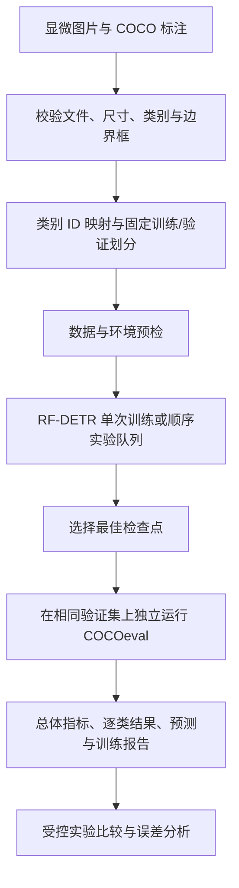
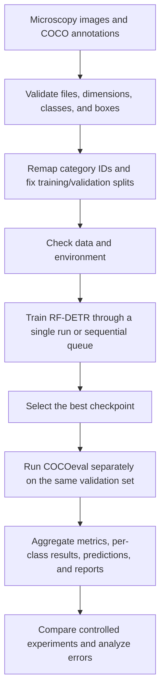

# PollenVision

**面向显微花粉图像的目标检测与可复现研究流程**

**Microscopic Pollen Detection and Reproducible Research with RF-DETR**

PollenVision 是一个面向显微花粉图像的计算机视觉研究项目。项目以 RF-DETR 目标检测为当前基线，围绕有限标注条件下的花粉定位、类别识别与实验可追溯性，建立从 COCO 数据校验、固定划分到训练、评估和报告的完整流程，并为后续自监督表征学习与模型解释研究提供基础。

PollenVision is a computer vision research project for microscopic pollen images. Using RF-DETR as its current detection baseline, it addresses pollen localization, classification under limited annotations, and experiment traceability through a complete workflow from COCO data validation and fixed splits to training, evaluation, and reporting. This foundation supports future research into self-supervised representation learning and model interpretation.

[中文说明](#中文说明) · [English](#english) · [训练指南](docs/TRAINING_GUIDE.md) · [640 分辨率实验](docs/RESOLUTION_EXPERIMENT.md)

## 中文说明

### 目录

- [项目背景与定位](#项目背景与定位)
- [研究目标](#研究目标)
- [当前进展](#当前进展)
- [方法与实验流程](#方法与实验流程)
- [数据集与划分](#数据集与划分)
- [实验设置与结果](#实验设置与结果)
- [环境与安装](#环境与安装)
- [数据准备](#数据准备)
- [训练与评估](#训练与评估)
- [实验产物](#实验产物)
- [测试与代码结构](#测试与代码结构)
- [研究路线图](#研究路线图)
- [文档与技术参考](#文档与技术参考)

### 项目背景与定位

显微花粉识别需要同时处理目标定位与细粒度类别判别。不同类别可能具有相近的外形、纹理和尺度，同类目标也可能因成像条件、观察方向与焦平面变化呈现不同外观。在标注数量有限、类别分布不均衡的条件下，模型整体指标的提升未必意味着少数类识别能力同步改善。

PollenVision 将这些问题组织为可检验的研究任务：先建立数据来源、训练配置和评估口径清晰的检测基线，再通过受控实验分析输入分辨率、优化策略和数据分布对结果的影响。项目关注的不只是一次训练得到的分数，也包括分数对应的数据、检查点、阈值与复现条件。

当前仓库定位为**研究代码与实验工作流**，任务范围为二维显微图像中的花粉边界框检测，输出目标位置、类别和置信度。现阶段尚未提供实例分割、生产部署服务或经过跨设备验证的应用系统。公开结果属于当前小规模数据集上的阶段性验证结果。

### 研究目标

项目延续三个相互衔接的研究方向：

| 方向 | 核心问题 | 当前状态 |
| --- | --- | --- |
| 花粉目标检测 | 如何在有限标注下完成花粉实例定位与类别识别，并建立可比较的基线？ | 已实现 RF-DETR 训练与评估流程，完成 50 轮基线及分辨率对照 |
| 自监督表征学习 | 能否利用未标注显微图像改善特征表达和低样本类别的迁移能力？ | 规划中；尚未实现项目自有的自监督预训练或特征融合实验 |
| 模型解释与误差分析 | 模型依据哪些图像区域作出判断，误检与漏检集中在哪些类别和条件？ | 已输出逐类指标与预测结果；可解释性方法尚未集成 |

当前代码的主要工作是将 RF-DETR SDK 组织为可追溯的实验流程。独立的网络结构创新、自监督训练收益和解释方法有效性，均需要后续实现与实验验证。

### 当前进展

截至 **2026-10-13**：

- 已完成 RF-DETR Nano 的 50 轮基线与 640 分辨率对照实验。
- 当前数据：107 张图片、787 个框、15 类；固定训练/验证划分为 76/31 张，599/188 个框。
- 支持顺序实验队列、数据与配置 SHA-256 校验、成功任务跳过、失败任务受控恢复。
- 训练完成后自动加载 `checkpoint_best_total.pth`，生成独立 COCOeval 指标、逐类结果、逐轮 CSV 和训练曲线。
- 640 评估显式恢复实验分辨率与位置编码尺寸，报告记录实际推理分辨率，避免 SDK 加载权重后回落到默认尺寸。

工程流程已从早期单轮试跑推进到正式轮数的受控实验阶段。旧版 README 中的 5/6 类数据与 smoke test 记录属于历史阶段，不与当前 15 类固定划分直接比较。

### 方法与实验流程

项目采用预训练 RF-DETR Nano 进行迁移学习，使用 COCO 格式的边界框标注。训练与模型实现依赖上游 RF-DETR；本仓库负责数据准备、实验组织、独立评估和结果归档。



流程中的关键约定：

- **数据一致性：**划分由固定种子生成并保存清单；同一组对照实验复用已有 processed 数据，记录图片与标注哈希。
- **实验隔离：**每次训练保存配置、软件版本、源码哈希、日志和检查点，已有实验目录默认拒绝覆盖。
- **评估一致性：**训练结束后加载最佳权重重新推理，使用统一的 COCOeval 和固定阈值指标进行跨实验比较。
- **失败可追溯：**队列记录任务状态，跳过已成功任务；恢复时检查配置与数据是否一致，并保留历史训练目录。

这里的“独立评估”指独立于训练器运行评估代码，**仍使用同一验证集，不表示存在独立测试集**。固定种子与运行记录便于复核实验，但不保证不同硬件和依赖版本之间逐位一致。

### 数据集与划分

当前使用本地维护的 v2 COCO 数据集，仅处理 bbox 检测标注。

| 划分 | 图片数 | 标注框数 | 有标注的类别数 |
| --- | ---: | ---: | ---: |
| 训练集 | 76 | 599 | 15 |
| 验证集 | 31 | 188 | 9 |
| 合计 | 107 | 787 | 15 |

划分种子为 42，配置训练比例为 0.7；切分器在保证训练类别覆盖后得到上述实际数量。原始类别 ID 0–14 在准备阶段映射为连续的 1–15，文件映射和划分记录写入 `split_manifest.json`。

数据存在明显的长尾分布：樟约占全部标注的 61%，广玉兰仅有 1 个标注框。另有 52 张原始图片未进入当前 COCO 标注，不能据此将它们作为无目标负样本。当前划分没有独立测试集，也尚需针对同一玻片、相邻视野和近重复图像进行分组与泄漏审查。

**数据可用性：**仓库不分发原始图片、标注、处理后数据或训练权重。运行工作流需要自行取得可使用的数据；复核下述数值还需要对应的数据版本与实验产物。数据布局见[数据说明](data/README.md)，当前数据审计记录见 [DATA_V2_AUDIT.json](docs/DATA_V2_AUDIT.json)。

### 实验设置与结果

#### 对照设计

两组均训练 50 轮，batch=2、梯度累积=1、主学习率 `1e-4`、seed=42，并使用相同数据与预训练起点。D 组仅显式新增 `training.resolution: 640`，保留 SDK 多尺度训练与 EMA。

| 设置 | A：基线 | D：分辨率对照 |
| --- | --- | --- |
| 模型 | RF-DETR Nano | RF-DETR Nano |
| 训练轮数 / batch / 梯度累积 | 50 / 2 / 1 | 50 / 2 / 1 |
| 主学习率 / 随机种子 | `1e-4` / 42 | `1e-4` / 42 |
| 验证与推理分辨率 | 384 | 640 |
| SDK 训练输入候选范围 | 224–544，步长 32 | 480–800，步长 32 |
| 位置编码尺寸 | 24 | 40 |
| 最佳轮次（1 起算） | 40 | 36 |

384/640 表示验证与推理尺寸，并非每个训练 batch 都使用该固定尺寸。分辨率设置同时影响 SDK 的训练尺度范围和位置编码尺寸；本实验衡量的是这一配置变化的整体效果，不能单独归因于推理分辨率。

#### 评估协议

- **AP：**使用 `pycocotools.COCOeval`，IoU 范围为 0.50:0.05:0.95，101 点插值，`maxDets=[1, 10, 100]`。推理分数阈值设为 0，保留候选用于排序评估，并排除额外背景槽。
- **Precision / Recall / F1：**在 confidence=0.5、IoU=0.5 的固定工作点统计 TP、FP、FN，报告微平均结果。
- **检查点：**统一使用 `checkpoint_best_total.pth`。最佳权重由验证表现选择，训练器逐轮指标与独立评估结果分别保存。
- **缺失类别：**无验证标注的类别报告 N/A，不将缺失评估记为零分；总体 AP 不能解读为全部 15 类均得到有效验证。

#### 总体结果

| 独立验证指标 | A：384 | D：640 | D − A（百分点） |
| --- | ---: | ---: | ---: |
| mAP50–95 | 46.41% | **54.39%** | **+7.98** |
| mAP50 | 60.49% | 63.28% | +2.79 |
| mAP75 | 50.64% | 60.20% | +9.55 |
| Precision | 87.74% | 81.42% | −6.32 |
| Recall | 72.34% | 79.26% | +6.91 |
| F1 | 79.30% | 80.32% | +1.02 |

差值按未四舍五入的原始指标计算，因此可能与表内已舍入数值相减略有不同。

| 检测计数与运行记录 | A：384 | D：640 |
| --- | ---: | ---: |
| TP / FP / FN | 136 / 19 / 52 | 149 / 34 / 39 |
| 训练耗时（分钟） | 19.76 | 25.25 |

#### 结果解读与适用边界

640 提高了整体检测表现，但误检从 19 增加到 34，漏检从 52 减少到 39。构、银杏的 AP 改善，蓝花楹略降；白玉兰、山玉兰在固定阈值下仍未正确检出。训练耗时约 25.25 分钟，A 组约 19.76 分钟；耗时包含运行开销。

**评估限制：**仅一次随机种子实验，验证集同时用于选择最佳权重，仅覆盖 9/15 类，没有独立测试集。无验证样本的类别显示 N/A；上述结果不能代表全部类别或证明统计显著性。详细设置、逐类结果和复现命令见[实验说明](docs/RESOLUTION_EXPERIMENT.md)。

因此，640 配置可作为后续优化的候选基线，但仍需补充少数类数据、多随机种子实验与独立测试。训练耗时是在本机环境下记录的运行结果，不能作为纯推理延迟或实时部署能力的依据。

### 环境与安装

已验证平台为 Windows、Python 3.11、RTX 5060 8GB、CUDA 12.8 版 PyTorch。批量队列使用 Windows 文件锁；Linux/macOS 尚未验证，当前队列实现不能直接视为跨平台支持。

| 组件 | 用途 |
| --- | --- |
| PyTorch / TorchVision | 张量计算、CUDA 训练与视觉基础组件 |
| RF-DETR（`rfdetr[train]`） | 检测模型、预训练权重及训练栈 |
| pycocotools | COCO 数据接口与标准检测评估 |
| NumPy / pandas / PyYAML | 数据处理、指标汇总与配置管理 |
| Pillow / OpenCV / Matplotlib | 图像读取、可视化与训练曲线 |

安装前需准备 Python 3.11、可用的 NVIDIA 驱动与 Git。获取仓库：

```powershell
git clone https://github.com/LorenzoTang/pollen_project.git
Set-Location pollen_project
```

以下 PowerShell 命令均从仓库根目录执行：

```powershell
powershell -ExecutionPolicy Bypass -File .\scripts\setup_windows_cuda.ps1
$env:PYTHONUTF8 = '1'
$env:PYTHONIOENCODING = 'utf-8'
& .\.venv\Scripts\python.exe .\src\check_environment.py --require-cuda
```

安装脚本创建 `.venv`，先从 PyTorch 官方 CUDA 12.8 索引安装 `torch/torchvision`，再安装 `requirements.txt`。首次训练可能下载 RF-DETR 预训练权重。依赖尚未完整锁定；复现实验时应参考本地 `run_manifest.json` 中的软件版本。

### 数据准备

**GitHub 仓库不包含原始图片、标注、处理后数据或训练权重。** 需要自行取得可使用的数据，并按[数据说明](data/README.md)放置，或修改 `configs/rfdetr_baseline.yaml` 中的路径。

```powershell
& .\.venv\Scripts\python.exe .\src\check_data.py --config .\configs\rfdetr_baseline.yaml
& .\.venv\Scripts\python.exe .\src\prepare_rfdetr_dataset.py --config .\configs\rfdetr_baseline.yaml
& .\.venv\Scripts\python.exe .\src\train_rfdetr.py --config .\configs\rfdetr_baseline.yaml --preflight-only
```

准备脚本将原始 COCO 类别 ID 转成连续的 1–15，并保存图片映射、固定划分和统计。已有输出默认拒绝覆盖；确需重新生成时使用 `--overwrite`。同一组对照实验必须复用相同 prepared 数据，不重新划分。

### 训练与评估

准备好数据后，可先运行单次 384 基线。实验名称必须尚未使用，避免覆盖已有结果：

```powershell
& .\.venv\Scripts\python.exe .\src\train_rfdetr.py `
  --config .\configs\rfdetr_baseline.yaml `
  --experiment-name pollen_nano_seed42
```

基础配置保留 A 组的默认 384 分辨率。推荐通过独立的 640 队列配置运行 D 组：

```powershell
# 1 轮流程验证（可选）
& .\.venv\Scripts\python.exe .\src\run_batch.py --manifest .\configs\batch_resolution640_smoke.yaml

# 50 轮正式实验：先预检，再训练
& .\.venv\Scripts\python.exe .\src\run_batch.py --manifest .\configs\batch_resolution640.yaml --dry-run
& .\.venv\Scripts\python.exe .\src\run_batch.py --manifest .\configs\batch_resolution640.yaml
```

其他入口与任务：

| 入口 / 配置 | 用途 |
| --- | --- |
| `src/run_pipeline.py` | 数据检查、准备、训练与报告；`--reuse-prepared` 复用已有划分 |
| `src/train_rfdetr.py` | 单次训练；支持 `--preflight-only`、`--resume-from`、`--report-only` |
| `configs/batch_v2.yaml` | A/B/C：主学习率与梯度累积对照，各 50 轮 |
| `configs/batch_smoke.yaml` | 批量流程短验证 |
| `scripts/compare_resolution.py` | 校验 A/D 可比性并输出 Markdown、JSON、CSV 对照 |

队列再次执行会跳过成功任务；失败任务通过同一命令追加 `--resume-failed` 恢复。改变任务配置或数据时应使用新的队列目录。

训练会自动评估，无需另外寻找“最新”权重。手动重评时，使用该实验保存的完整 `config.yaml` 与 `--experiment-dir`，确保 640 配置生效。完整命令和恢复规则见[训练指南](docs/TRAINING_GUIDE.md)。

### 实验产物

每次实验保存到独立的 `experiments/<experiment-name>/`：

```text
config.yaml
run_manifest.json              # 配置、数据哈希、源码哈希、软件版本
run_status.json                # 训练/评估状态与耗时
checkpoints/                   # 最佳权重、恢复检查点、SDK 配置与指标
logs/                          # 训练与独立评估日志
results/
  training_report.md
  training_report.json
  evaluation_report.json
  epoch_metrics.csv
  per_class_metrics.csv
  predictions_coco.json
  training_curves.png
```

这些产物保留在本地，不提交 Git。适合公开的实验摘要维护在 `docs/`。

### 测试与代码结构

```powershell
& .\.venv\Scripts\python.exe -m unittest discover -s .\tests -v
git diff --check
```

测试覆盖数据校验与防覆盖、配置解析、流水线、队列恢复、COCO 指标、训练报告及分辨率传递。测试包含模拟训练；通过测试不等于重新完成了 GPU 训练。

```text
configs/       # 基线、试跑与批量实验配置
src/           # 数据准备、训练、评估、队列与报告
scripts/       # Windows CUDA 安装、分辨率结果对比
tests/         # unittest 回归测试
docs/          # 训练指南、数据历史审计、实验说明
data/          # 仅说明文件纳入 Git；数据在本地管理
experiments/   # 本地实验产物，Git 忽略
```

### 研究路线图

| 阶段 | 目标与交付 | 状态 |
| --- | --- | --- |
| Phase 1：检测流程 | 数据校验、固定划分、训练入口、检查点与日志 | 已实现，并完成 GPU 试跑 |
| Phase 2：基线与受控实验 | 50 轮实验、独立评估、逐类报告、分辨率对照 | 已取得阶段性结果；数据扩充和更充分的泛化验证仍待完成 |
| Phase 3：表征学习 | 在明确数据划分的前提下研究自监督特征与低样本迁移 | 规划中 |
| Phase 4：模型解释 | 结合检测误差与可解释性方法分析模型行为 | 规划中 |

近期工作优先围绕当前实验暴露的问题展开：

1. **改善数据覆盖。**补充少数类的真实标注，审查近重复图像与玻片分组，建立覆盖更多类别的验证和独立测试方案。
2. **开展单变量优化。**分别验证较小的编码器学习率、温和的方向/亮度增强和弱类采样，保持数据版本与评估协议一致。
3. **检验结果稳定性。**进行多随机种子实验，记录均值与波动，并区分阈值选择和最终测试。
4. **扩展研究方法。**在检测基线稳定后，评估自监督表征学习与模型解释的实际收益。

这些后续优化尚未实施，当前训练入口尚未透传 `lr_encoder` 或自定义增强配置。路线图描述研究计划，不代表已提供对应功能。

### 文档与技术参考

| 文档 | 阅读用途 |
| --- | --- |
| [数据说明](data/README.md) | 本地数据布局、类别 ID 映射与数据可用性 |
| [训练指南](docs/TRAINING_GUIDE.md) | 环境、数据准备、训练、恢复及报告的详细操作 |
| [分辨率实验](docs/RESOLUTION_EXPERIMENT.md) | A/D 实验约束、逐类结果与比较命令 |
| [数据审计记录](docs/DATA_V2_AUDIT.json) | v2 数据统计与文件审计信息 |
| [训练就绪历史快照](docs/TRAINING_READINESS_V2.md) | 2026-10-12 首次试跑时的状态；后续进展以本文和实验说明为准 |

当前实现依赖 [RF-DETR](https://github.com/roboflow/rf-detr)、[PyTorch](https://pytorch.org/) 和 [COCO API](https://github.com/cocodataset/cocoapi)。[DINOv2](https://github.com/facebookresearch/dinov2) 与 [Captum](https://github.com/pytorch/captum) 是后续表征学习、模型解释方向的技术参考；仓库尚未提供独立的 DINOv2 自监督训练流程或 Captum 集成。

提交问题或实验改动时，建议附上运行命令、环境版本、相关配置和脱敏日志。涉及检测性能的改动应报告数据版本、评估协议与逐类结果，便于区分工程修正与模型效果变化。

## English

### Table of contents

- [Background and scope](#background-and-scope)
- [Research objectives](#research-objectives)
- [Current status](#current-status)
- [Method and experimental workflow](#method-and-experimental-workflow)
- [Dataset and splits](#dataset-and-splits)
- [Experimental setup and results](#experimental-setup-and-results)
- [Environment and installation](#environment-and-installation)
- [Data preparation](#data-preparation)
- [Training and evaluation](#training-and-evaluation)
- [Experiment artifacts](#experiment-artifacts)
- [Tests and repository structure](#tests-and-repository-structure)
- [Research roadmap](#research-roadmap)
- [Documentation and technical references](#documentation-and-technical-references)

### Background and scope

Microscopic pollen recognition combines object localization with fine-grained classification. Different classes can share similar shapes, textures, and scales, while instances of the same class can look different under changes in imaging conditions, viewing direction, and focal plane. With limited annotations and imbalanced classes, an improvement in aggregate metrics does not necessarily imply better recognition of minority classes.

PollenVision turns these challenges into testable research questions: first establish a detection baseline with clear data provenance, training configurations, and evaluation protocols, then use controlled experiments to study the effects of input resolution, optimization strategies, and data distribution. The project records not only a training score but also the data, checkpoint, thresholds, and reproduction conditions behind it.

The repository currently provides **research code and an experimental workflow** for bounding-box detection in two-dimensional microscopy images, producing object locations, classes, and confidence scores. It does not yet provide instance segmentation, a production deployment service, or an application validated across acquisition devices. Published results are interim validation findings on the current small dataset.

### Research objectives

The project follows three connected research directions:

| Direction | Objective | Status |
| --- | --- | --- |
| Pollen object detection | Localize and classify pollen instances under limited annotations and establish comparable baselines | RF-DETR training and evaluation implemented; 50-epoch baseline and resolution experiments completed |
| Self-supervised representation learning | Investigate whether unlabeled microscopy images improve representations and transfer to classes with few examples | Planned; no project-specific self-supervised pretraining or feature-fusion experiments yet |
| Model interpretation and error analysis | Identify image regions supporting decisions and the classes and conditions associated with false positives and false negatives | Per-class metrics and predictions available; explainability methods not yet integrated |

The current implementation organizes the RF-DETR SDK into a traceable experimental workflow. Independent architectural innovations, gains from self-supervised training, and the effectiveness of interpretation methods require further implementation and experimental validation.

### Current status

As of **2026-10-13**:

- RF-DETR Nano has completed a 50-epoch baseline and a controlled 640-resolution experiment.
- The current dataset contains 107 images, 787 boxes, and 15 classes, with a fixed split of 76/31 training/validation images and 599/188 boxes.
- Sequential experiment queues support data and configuration SHA-256 checks, skipping successful tasks, and controlled recovery of failed tasks.
- Training automatically loads `checkpoint_best_total.pth` afterward to produce independent COCOeval metrics, per-class results, epoch CSV files, and training curves.
- Evaluation explicitly restores the resolution and positional encoding size for 640 runs and records the actual inference resolution, preventing fallback to the SDK default when loading weights.

The workflow has progressed from early single-epoch smoke tests to controlled experiments with the planned full training duration. The 5/6-class datasets and smoke-test results described in earlier README versions are historical records and are not directly comparable with the current fixed 15-class split.

### Method and experimental workflow

The project fine-tunes pretrained RF-DETR Nano using COCO bounding-box annotations. The model and training implementation come from upstream RF-DETR; this repository handles data preparation, experiment organization, independent evaluation, and result archiving.



Key workflow conventions:

- **Data consistency:** generate the split with a fixed seed and save its manifest; reuse the prepared data within each comparison and record image and annotation hashes.
- **Experiment isolation:** save configurations, software versions, source hashes, logs, and checkpoints for each run; reject existing experiment directories by default.
- **Evaluation consistency:** reload the best weights after training and use the same COCOeval protocol and fixed-threshold metrics for comparisons.
- **Traceable failures:** record task states and skip successful tasks; verify data and configuration identity during recovery and preserve previous training directories.

“Independent evaluation” means running evaluation code separately from the trainer **on the same validation set; it does not imply an independent test set**. Fixed seeds and run records support reproduction but do not guarantee bitwise identical results across hardware or dependency versions.

### Dataset and splits

The current locally maintained v2 COCO dataset is used for bounding-box detection only.

| Split | Images | Boxes | Represented classes |
| --- | ---: | ---: | ---: |
| Training | 76 | 599 | 15 |
| Validation | 31 | 188 | 9 |
| Total | 107 | 787 | 15 |

The split uses seed 42 and a configured training ratio of 0.7, yielding the counts above after adjustments to retain training-class coverage. Original category IDs 0–14 are remapped to contiguous IDs 1–15 during preparation. File mappings and split records are saved in `split_manifest.json`.

The dataset has a pronounced long-tail distribution: the class 樟 accounts for approximately 61% of all annotations, while 广玉兰 has only one box. Another 52 raw images are absent from the current COCO annotations and must not be assumed to be negative samples. There is no independent test set. Grouping and leakage checks for images from the same slide, adjacent fields of view, and near duplicates remain necessary.

**Data availability:** raw images, annotations, prepared data, and training weights are not distributed in this repository. Running the workflow requires a dataset you are permitted to use; reproducing the numbers below also requires the corresponding data version and experiment artifacts. See the [dataset guide](data/README.md) for the layout and [DATA_V2_AUDIT.json](docs/DATA_V2_AUDIT.json) for the current audit records. Chinese category names are retained to match the annotation and report labels.

### Experimental setup and results

#### Comparison design

The A/D comparison uses RF-DETR Nano, 50 epochs, batch size 2, gradient accumulation 1, a main learning rate of `1e-4`, seed 42, the same prepared data, and the same pretrained starting point. Run D adds `training.resolution: 640`; EMA and SDK multi-scale training remain enabled.

| Setting | A: baseline | D: resolution experiment |
| --- | --- | --- |
| Model | RF-DETR Nano | RF-DETR Nano |
| Epochs / batch size / gradient accumulation | 50 / 2 / 1 | 50 / 2 / 1 |
| Main learning rate / random seed | `1e-4` / 42 | `1e-4` / 42 |
| Validation and inference resolution | 384 | 640 |
| SDK training-size candidates | 224–544, step 32 | 480–800, step 32 |
| Positional encoding size | 24 | 40 |
| Best epoch (1-based) | 40 | 36 |

384 and 640 denote validation/inference resolutions. The change also shifts the training-size candidates from 224–544 to 480–800, both in steps of 32, and changes the positional encoding size from 24 to 40. Results therefore measure the overall resolution configuration, not an isolated inference-only change.

#### Evaluation protocol

- **AP:** use `pycocotools.COCOeval` with IoU 0.50:0.05:0.95, 101-point interpolation, and `maxDets=[1, 10, 100]`. Set the inference score threshold to 0 to retain candidates for ranked evaluation, excluding the extra background slot.
- **Precision / Recall / F1:** count TP, FP, and FN at confidence=0.5 and IoU=0.5, reporting micro-averaged results.
- **Checkpoint:** consistently use `checkpoint_best_total.pth`, selected by validation performance. Store training-loop metrics separately from independent evaluation results.
- **Missing classes:** report N/A for classes without validation annotations instead of treating missing evaluations as zero scores. Aggregate AP does not mean that all 15 classes have been meaningfully evaluated.

#### Aggregate results

| Validation metric | A: 384 | D: 640 | Change (percentage points) |
| --- | ---: | ---: | ---: |
| COCO mAP50–95 | 46.41% | **54.39%** | **+7.98** |
| mAP50 | 60.49% | 63.28% | +2.79 |
| mAP75 | 50.64% | 60.20% | +9.55 |
| Precision | 87.74% | 81.42% | −6.32 |
| Recall | 72.34% | 79.26% | +6.91 |
| F1 | 79.30% | 80.32% | +1.02 |

Changes are computed from unrounded values and may therefore differ slightly from subtracting the rounded values shown in the table.

| Detection counts and runtime records | A: 384 | D: 640 |
| --- | ---: | ---: |
| TP / FP / FN | 136 / 19 / 52 | 149 / 34 / 39 |
| Training time (minutes) | 19.76 | 25.25 |

#### Interpretation and limitations

The 640 configuration improved aggregate detection performance, reducing false negatives from 52 to 39 while increasing false positives from 19 to 34. AP improved for 构 and 银杏 and decreased slightly for 蓝花楹. 白玉兰 and 山玉兰 still had no correct detections at the fixed threshold. Training took approximately 25.25 minutes versus 19.76 for run A, including runtime overhead.

**Limitations:** these are single-seed validation results. The validation set is also used to select checkpoints, covers only 9 of 15 classes, and is not an independent test set. Classes without validation annotations are reported as N/A. The results establish neither statistical significance nor reliable performance across all classes. Full per-class outcomes and experiment constraints are documented in the [resolution report](docs/RESOLUTION_EXPERIMENT.md).

The 640 configuration is therefore a candidate baseline for further optimization, pending additional minority-class data, experiments across seeds, and independent testing. Training time was recorded in the local environment and is not evidence of inference latency or real-time deployment capability.

### Environment and installation

The tested platform is Windows, Python 3.11, and CUDA 12.8 PyTorch on an RTX 5060 with 8 GB VRAM. The batch queue uses Windows file locking. Linux/macOS execution has not been validated, and the current queue implementation should not be assumed to support those platforms directly.

| Component | Purpose |
| --- | --- |
| PyTorch / TorchVision | Tensor computation, CUDA training, and vision utilities |
| RF-DETR (`rfdetr[train]`) | Detection model, pretrained weights, and training stack |
| pycocotools | COCO data interfaces and standard detection evaluation |
| NumPy / pandas / PyYAML | Data processing, metric summaries, and configuration management |
| Pillow / OpenCV / Matplotlib | Image loading, visualization, and training curves |

Before installation, prepare Python 3.11, a working NVIDIA driver, and Git. Clone the repository:

```powershell
git clone https://github.com/LorenzoTang/pollen_project.git
Set-Location pollen_project
```

Run the following PowerShell commands from the repository root:

```powershell
powershell -ExecutionPolicy Bypass -File .\scripts\setup_windows_cuda.ps1
$env:PYTHONUTF8 = '1'
$env:PYTHONIOENCODING = 'utf-8'
& .\.venv\Scripts\python.exe .\src\check_environment.py --require-cuda
```

The setup script creates `.venv`, installs `torch/torchvision` from the official PyTorch CUDA 12.8 index, then installs `requirements.txt`. The first training run may download RF-DETR pretrained weights. Dependencies are not fully pinned; consult the software versions in the local `run_manifest.json` when reproducing an experiment.

### Data preparation

**The GitHub repository does not include raw images, annotations, prepared datasets, or training weights.** Obtain data you are permitted to use and place it according to the [dataset guide](data/README.md), or update the paths in `configs/rfdetr_baseline.yaml`.

```powershell
& .\.venv\Scripts\python.exe .\src\check_data.py --config .\configs\rfdetr_baseline.yaml
& .\.venv\Scripts\python.exe .\src\prepare_rfdetr_dataset.py --config .\configs\rfdetr_baseline.yaml
& .\.venv\Scripts\python.exe .\src\train_rfdetr.py --config .\configs\rfdetr_baseline.yaml --preflight-only
```

The preparation script remaps the original COCO category IDs to contiguous IDs 1–15 and saves file mappings, fixed splits, and statistics. It rejects existing output by default; use `--overwrite` only when regeneration is intended. Reuse the same prepared dataset throughout a controlled comparison instead of creating a new split.

### Training and evaluation

After preparing the data, you can run a single 384 baseline. Choose an unused experiment name to avoid overwriting previous results:

```powershell
& .\.venv\Scripts\python.exe .\src\train_rfdetr.py `
  --config .\configs\rfdetr_baseline.yaml `
  --experiment-name pollen_nano_seed42
```

The base configuration retains run A's default resolution of 384. Use the separate 640 queue configuration to run experiment D:

```powershell
# Optional one-epoch workflow check
& .\.venv\Scripts\python.exe .\src\run_batch.py --manifest .\configs\batch_resolution640_smoke.yaml

# Full 50-epoch experiment: check first, then train
& .\.venv\Scripts\python.exe .\src\run_batch.py --manifest .\configs\batch_resolution640.yaml --dry-run
& .\.venv\Scripts\python.exe .\src\run_batch.py --manifest .\configs\batch_resolution640.yaml
```

Other entry points and tasks:

| Entry point / configuration | Purpose |
| --- | --- |
| `src/run_pipeline.py` | Data checks, preparation, training, and reports; `--reuse-prepared` retains an existing split |
| `src/train_rfdetr.py` | Single-run training; supports `--preflight-only`, `--resume-from`, and `--report-only` |
| `configs/batch_v2.yaml` | A/B/C comparisons of main learning rate and gradient accumulation, 50 epochs each |
| `configs/batch_smoke.yaml` | Short batch-workflow check |
| `scripts/compare_resolution.py` | Verify A/D comparability and export Markdown, JSON, and CSV comparisons |

Rerunning the queue skips successful tasks. To recover failed tasks, append `--resume-failed` to the same command. Use a new queue directory if task configurations or data change.

Training evaluates automatically, so there is no need to search for the “latest” weights. For manual reevaluation, use the experiment's saved full `config.yaml` and `--experiment-dir` to preserve the 640 setting where applicable. See the [training guide](docs/TRAINING_GUIDE.md) for complete commands and recovery rules.

### Experiment artifacts

Each experiment is saved in a separate `experiments/<experiment-name>/` directory:

```text
config.yaml
run_manifest.json              # Configuration, data/source hashes, software versions
run_status.json                # Training/evaluation status and timing
checkpoints/                   # Best weights, recovery checkpoints, SDK config and metrics
logs/                          # Training and independent evaluation logs
results/
  training_report.md
  training_report.json
  evaluation_report.json
  epoch_metrics.csv
  per_class_metrics.csv
  predictions_coco.json
  training_curves.png
```

These artifacts remain local and are not committed to Git. Experiment summaries suitable for publication are maintained in `docs/`.

### Tests and repository structure

```powershell
& .\.venv\Scripts\python.exe -m unittest discover -s .\tests -v
git diff --check
```

Tests cover data validation, overwrite protection, configuration handling, pipeline execution, recovery, metrics, reports, and resolution propagation. Some use mocked training; passing them does not replace a GPU experiment.

```text
configs/       # Baseline, smoke-test, and batch experiment configurations
src/           # Data preparation, training, evaluation, queues, and reports
scripts/       # Windows CUDA setup and resolution comparisons
tests/         # unittest regression tests
docs/          # Training guide, historical data audits, and experiment reports
data/          # Documentation tracked in Git; datasets managed locally
experiments/   # Local experiment artifacts, ignored by Git
```

### Research roadmap

| Phase | Objectives and deliverables | Status |
| --- | --- | --- |
| Phase 1: detection workflow | Data validation, fixed splits, training entry point, checkpoints, and logs | Implemented and verified through GPU smoke tests |
| Phase 2: baselines and controlled experiments | 50-epoch runs, independent evaluation, per-class reports, and resolution comparisons | Interim results available; data expansion and broader generalization evaluation remain pending |
| Phase 3: representation learning | Study self-supervised features and transfer with few examples under clearly defined data splits | Planned |
| Phase 4: model interpretation | Analyze model behavior through detection errors and explainability methods | Planned |

Near-term work addresses the issues identified in the current experiments:

1. **Improve data coverage.** Add real annotations for minority classes, audit near duplicates and slide grouping, and establish validation and independent testing with broader class coverage.
2. **Optimize one factor at a time.** Separately investigate a lower encoder learning rate, mild orientation/brightness augmentation, and minority-class sampling while keeping the data version and evaluation protocol fixed.
3. **Assess stability.** Run experiments across random seeds, report means and variability, and separate threshold selection from final testing.
4. **Extend the research methods.** Once the detection baseline is stable, evaluate the practical benefits of self-supervised representation learning and model interpretation.

These future optimizations have not been implemented. The current training entry point does not expose `lr_encoder` or custom augmentation settings. The roadmap describes planned research rather than available features.

### Documentation and technical references

| Document | Purpose |
| --- | --- |
| [Dataset guide](data/README.md) | Local data layout, category ID mapping, and data availability |
| [Training guide](docs/TRAINING_GUIDE.md) | Detailed environment setup, data preparation, training, recovery, and reporting instructions |
| [Resolution experiment](docs/RESOLUTION_EXPERIMENT.md) | A/D constraints, per-class results, and comparison commands |
| [Data audit records](docs/DATA_V2_AUDIT.json) | v2 data statistics and file audit information |
| [Historical training-readiness snapshot](docs/TRAINING_READINESS_V2.md) | State at the first smoke test on 2026-10-12; consult this README and the experiment report for subsequent progress |

The current implementation relies on [RF-DETR](https://github.com/roboflow/rf-detr), [PyTorch](https://pytorch.org/), and the [COCO API](https://github.com/cocodataset/cocoapi). [DINOv2](https://github.com/facebookresearch/dinov2) and [Captum](https://github.com/pytorch/captum) are technical references for future representation learning and model interpretation; this repository does not yet provide a separate DINOv2 self-supervised training workflow or Captum integration.

When reporting issues or contributing experimental changes, include commands, environment versions, relevant configurations, and sanitized logs. Detection-performance changes should report the data version, evaluation protocol, and per-class results to help distinguish engineering corrections from changes in model performance.

## License

本项目代码采用 [MIT License](LICENSE)。数据集和第三方模型、依赖遵循各自授权；本仓库不包含数据或模型权重。

Project code is licensed under the [MIT License](LICENSE). Datasets, third-party models, and dependencies retain their respective licenses; this repository does not include datasets or model weights.